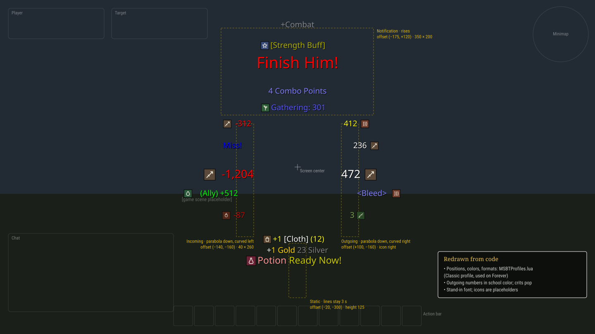
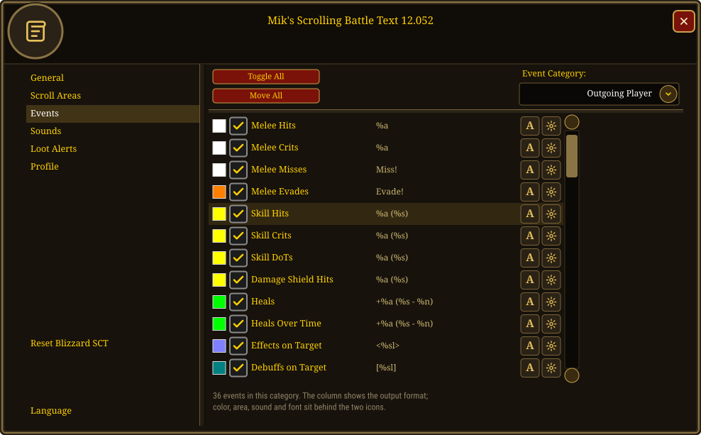
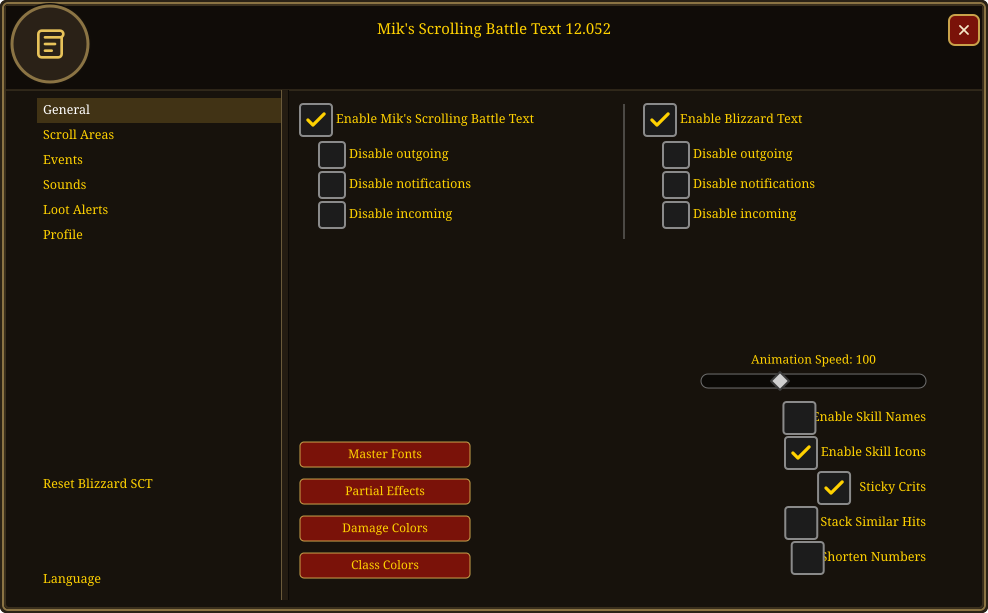
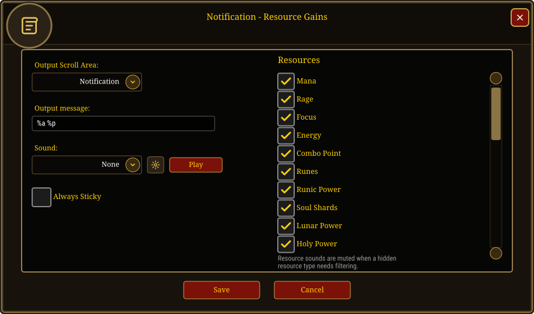
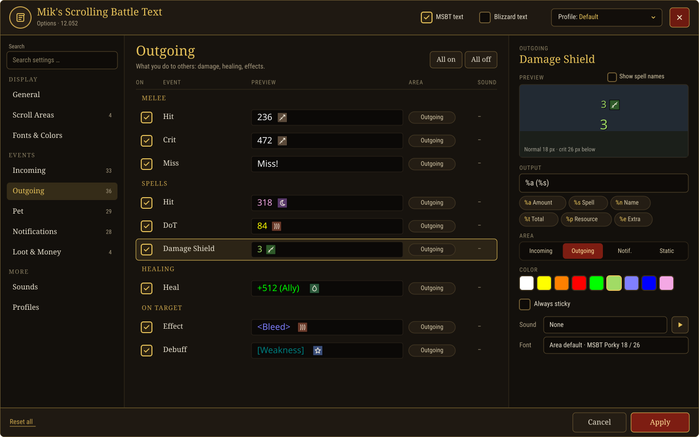
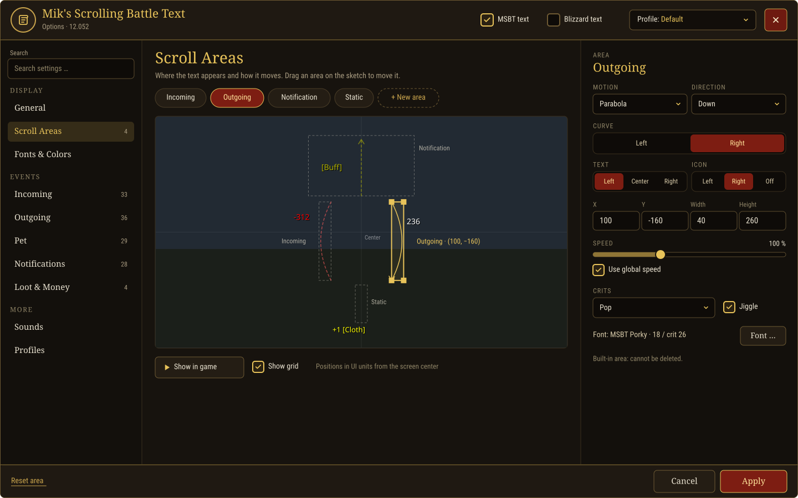
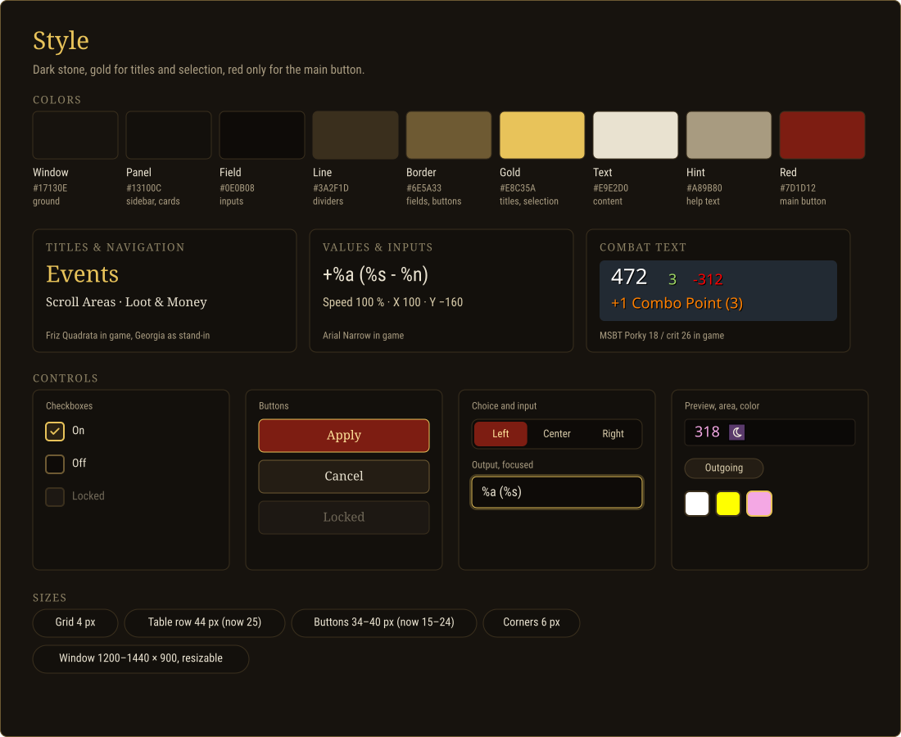

# Options redesign

Mockups of the MSBT interface and a reworked options window in a WoW Forever (classic) look.

- Redrawn from code, not from in-game captures
- English text, generic names, placeholder icons
- No game art; fonts are stand-ins
- Mockups are SVG files beside this document, shown as images

## Screens

| Section | Shows |
|---|---|
| Current: in game | Default scroll areas with sample lines |
| Current: Events tab | Options window, Events tab |
| Current: General tab | Options window, General tab |
| Current: Resource Gains popup | Event popup with the resource list |
| Proposal: events | One window, event table, detail panel |
| Proposal: scroll areas | Scroll area editor |
| Proposal: style | Tokens, type, controls |

## Current

### In game

| Area | Offset from center | Size | Motion |
|---|---|---|---|
| Incoming | −140, −160 | 40 × 260 | parabola down, curved left, right aligned |
| Outgoing | +100, −160 | 40 × 260 | parabola down, curved right, icon right |
| Notification | −175, +120 | 350 × 200 | rises, centered |
| Static | −20, −300 | height 125 | lines stay 3 s |

- Font MSBT Porky 18, crit 26, shadow only
- Crits pop, hold at the area middle and jiggle
- Outgoing numbers in school color
- Spell names hidden by default (`hideSkills`), icons shown

### Events tab

### General tab

### Resource Gains popup

- Window 790 × 490, character frame look, text tab list
- Event row: swatch · checkbox · format code · font button · settings button
- Each setting opens a popup: event, font, scroll area, colors

## Issues

- Untranslated labels mix languages on non-English clients
- Event list shows format codes, not the output
- Two icon buttons per row, one popup each
- Resource popup lists 30 resources; few exist on Forever
- Small targets: rows 25 px, buttons 15–20 px
- Profile is the last tab; Blizzard text sits under General

## Proposal

### Events

- One window
  - Header: profile, MSBT and Blizzard switches, close
  - Sidebar: search, pages grouped as Display, Events, More
  - Footer: reset, cancel, apply
- Event table: toggle · name · rendered preview · area · sound
- Detail panel instead of popups
  - Format field with token chips (`%a`, `%s`, `%n`, `%t`, `%p`, `%e`)
  - Live preview, normal and crit
  - Area, color, sticky, sound, font
  - "Show spell names" beside the preview

### Scroll areas

- Screen sketch: drag areas, see their paths
- Selected area: motion, direction, curve, text and icon alignment, X, Y, size, speed, crit style, font
- Built-in areas cannot be deleted

### Style

## Tokens

| Name | Hex | Use |
|---|---|---|
| Window | `#17130E` | ground |
| Panel | `#13100C` | sidebar, cards |
| Field | `#0E0B08` | inputs |
| Line | `#3A2F1D` | dividers |
| Border | `#6E5A33` | fields, buttons |
| Gold | `#E8C35A` | titles, selection |
| Text | `#E9E2D0` | content |
| Hint | `#A89B80` | help text |
| Red | `#7D1D12` | main button, one per window |

## Sizes and type

- Grid 4 px · rows 44 px · buttons 34–40 px · corners 6 px
- Window 1200–1440 × 900, resizable
- Titles, navigation: Friz Quadrata (Georgia in the mockups)
- Values, inputs: Arial Narrow
- Combat text: MSBT Porky (Arial Black in the mockups)

## Open

- Forever art and fonts not checked in game
- Docked mode inside the Blizzard Settings panel
- Size of the change: `MSBTOptions/*.lua` is about 6,600 lines
- Maintainer decision before any code

## Sources

- `MSBTProfiles.lua` (Classic profile, used on Forever)
- `Display/AnimationEngine.lua`, `Display/AnimationStyles.lua`
- `MSBTOptions/MSBTOptionsMain.lua`, `MSBTOptionsTabs.lua`, `MSBTOptionsControls.lua`, `MSBTOptionsPopups.lua`
